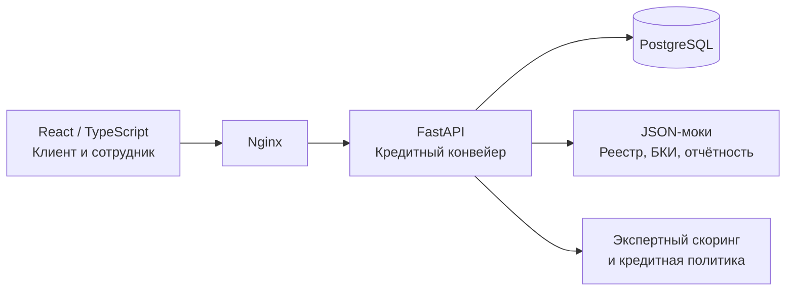

# Умный кредитный кабинет предпринимателя

**Альфа-Хак 2026 · работающий демонстрационный прототип**
**Репозиторий:** [oxyW647/alfa-hack-2026](https://github.com/oxyW647/alfa-hack-2026)
**Целевая аудитория:** индивидуальные предприниматели, малые и микропредприятия, сотрудники кредитного подразделения.

> **Идея:** единый цифровой кабинет, в котором предприниматель подаёт кредитную заявку и отслеживает её, а сотрудник банка видит объяснимую предварительную и итоговую оценку, проверяет документы и принимает решения в сложных случаях.

## Проблема и решение

Кредитование малого бизнеса предполагает сбор финансовых сведений, проверку документов и неоднократные уточнения. Предпринимателю важно понимать состояние заявки и следующий шаг, а банку — последовательно выполнять проверки и фиксировать, почему результат изменился.

Наш прототип объединяет в одном веб-приложении:

- **Кабинет предпринимателя:** создание и редактирование заявки, предоставление документов, отслеживание статуса и принятие демонстрационного предложения.
- **Кабинет сотрудника:** просмотр финансовой оценки и её факторов, документов, результатов проверок, истории изменения балла; решение о допуске к документам или итоговом одобрении/отказе.
- **Пятиэтапный кредитный конвейер:** скоринг → документы → проверки → повторный скоринг → кредитное решение.
- **Проверяемую кредитную политику:** пороги баллов, ограничения по критическим факторам риска и пересчёт допустимых альтернативных условий.


## Что реализовано

| Возможность | Как работает в прототипе |
|---|---|
| Заявка | Выбор демонстрационного сценария или заполнение анкеты: сведения о бизнесе, финансах, сумме и сроке кредита |
| Два уровня скоринга | Предварительная оценка по анкете и повторный расчёт по документам; обе оценки и их входные данные сохраняются |
| Документы | Получение JSON-документов из локального реестра по ИНН, возможность загрузки недостающих документов |
| Проверки | Регистрация бизнеса, доступность продукта, согласованность данных, антифрод и доверенность источника документов |
| Ручное рассмотрение | Сотрудник может допустить заявку к документам после предварительного среднего балла; финальное одобрение — отдельное действие |
| Кредитное решение | Отказ, ручная проверка или демонстрационное одобрение на основании баллов **и** проверок |
| Альтернативные условия | Поиск допустимой суммы/срока с повторным скорингом каждого кандидата, без обещания результата, если условия не проходят |
| Удобство для сотрудника | Вклад каждого фактора, финансовые метрики, предупреждения и изменение балла после документов |
| История и роли | PostgreSQL, история этапов и оценок, ролевое разграничение доступа клиента и сотрудника |

## Как принимается решение

### Экспертная скоринговая модель

На вход поступают данные бизнеса и запрашиваемого кредита. Шесть факторов дают от 0 до 100 баллов:

| Фактор | Максимум |
|---|---:|
| Покрытие долговых платежей денежным потоком (DSCR proxy) | 30 |
| Кредитная история бизнеса | 20 |
| Долг относительно собственного капитала (Debt/Equity) | 15 |
| Текущая ликвидность | 15 |
| Стабильность выручки за шесть месяцев | 15 |
| Срок деятельности бизнеса | 5 |
| **Итого** | **100** |

**Важно:** это детерминированная экспертная балльная модель, а не обученная ML-модель и не оценка вероятности дефолта. Балл 80 не означает 80% вероятности одобрения. Веса и пороги — допущения для MVP.

### Первичный этап — допуск к дальнейшей проверке

| Балл | Маршрут | Продолжение без участия сотрудника |
|---|---|---|
| **0–45** | `DECLINED` — отказ | Нет |
| **46–75** | `MANUAL_REVIEW` — ожидание сотрудника | Нет |
| **76–100** | `REQUEST_DOCUMENTS` — проверка документов | Да |

При первичных 66 баллах заявка не должна автоматически переходить к документам: сотрудник может разрешить продолжение проверки, но это не является одобрением кредита.

### Итоговый этап — решение после подтверждения данных

После получения документов выполняются проверки и повторный расчёт. При успешных обязательных проверках 76–100 баллов допускают демонстрационное автоодобрение, 46–75 — ручное рассмотрение, 0–45 — отказ. При этом критические результаты имеют приоритет над суммой баллов:

- неактивная регистрация или недоступный кредитный продукт — отказ;
- неуспешный/неподтверждённый антифрод, недоверенные документы, неположительный капитал, отсутствующий ответ БКИ либо серьёзная просрочка — ручное рассмотрение без автоматического одобрения;
- недостающие документы — запрос сведений.

Для альтернативного предложения система перебирает условия в границах продукта и заново рассчитывает скоринг: показывается только вариант, который проходит финальные правила, иначе предложение отсутствует. После ручного отказа ранее сформированную альтернативу принять нельзя.

**Демонстрационный продукт:** 300 000–25 000 000 ₽, срок 6–60 месяцев, условная ставка 24% годовых; сетка вариантов — 50 000 ₽ и 6 месяцев.

## Демонстрация

**Адрес после локального запуска:** <http://localhost:8080>. На стартовой странице роль демо-пользователя переключается между **клиентом** и **сотрудником**. В интерфейсе используется демонстрационный вход без отдельной формы авторизации.

**Сценарий А — изменение оценки после подтверждения (основной):**

1. В роли клиента открыть **«Новая заявка»** и выбрать карточку кофейни с падением оценки после проверки документов (`cafe`). Создать заявку.
2. Нажать **«Запустить всё»**. Предварительная оценка — **92**, переход к документам разрешён.
3. Переключиться на сотрудника: после проверки документов оценка становится **62**, маршрут — `MANUAL_REVIEW`. Показать сравнение **92 → 62**, факторы и расхождения.
4. Показать ручное решение сотрудника и новый статус в клиентском кабинете.

**Сценарий Б — защита от автоматического продолжения:**

1. Создать заявку из набора `medium_risk`.
2. Нажать **«Запустить всё»**: предварительная оценка **75**, маршрут `MANUAL_REVIEW`; последующие этапы **заблокированы**.
3. В роли сотрудника выбрать **«Допустить к документам»**. Повторный запуск конвейера даёт финальную оценку **65** и требует **отдельного** итогового ручного решения.

**Сценарий В — одобрение:** в демо-наборе `low_risk` итоговый балл **100** при положительных проверках; доступно демонстрационное предложение и его принятие.

Дополнительные сценарии: некорректные и неполные данные, неактивная регистрация, недостающие документы, стоп-факторы, альтернативные условия. Полный перечень с ожидаемыми результатами — в [docs/TEST_SCENARIOS.md](docs/TEST_SCENARIOS.md).

## Быстрый запуск

**Необходимы:** Docker Desktop / Docker Engine и Docker Compose.

```powershell
# Из корня репозитория, Windows PowerShell
Copy-Item .env.example .env
# При необходимости проверьте демо-конфигурацию в .env
docker compose up --build
```

Для Linux/macOS вместо `Copy-Item` используется `cp .env.example .env`. При повторном запуске копировать файл не нужно. Приложение: **http://localhost:8080**, Swagger UI: **http://localhost:8080/api/docs**.

```powershell
# Второй терминал: убедиться, что контейнеры запущены
docker compose ps

# Остановить приложение, сохранив том PostgreSQL
docker compose down
```

Контейнеры: PostgreSQL, FastAPI backend, сборка React frontend и Nginx. При первом запуске backend применяет миграции Alembic и создаёт демонстрационные учётные записи. Конфигурация лежит в `.env.example`; **настоящий `.env` не добавлять в Git**.

## Архитектура и технологии



| Часть | Стек |
|---|---|
| Frontend | React, TypeScript, Vite, Tailwind CSS |
| Backend/API | Python 3.12, FastAPI, Pydantic, SQLAlchemy (async), Gunicorn |
| Данные и миграции | PostgreSQL 16, Alembic |
| Доступ | JWT, роли клиента и сотрудника |
| Инфраструктура | Docker Compose, Nginx |
| Проверки | Pytest для backend, Ruff, ESLint, TypeScript/Vite build |

**Основные точки входа в код:** `backend/app/services/pipeline.py` (этапы), `scoring.py` (балл), `routing.py` (решение), `alternative_offer.py` (варианты условий), `frontend/src/features/applications/` (экраны). Финансовые данные и версии оценок хранятся отдельно от клиентского статуса.

## Проверки воспроизводимости

- Математическая модель сверена с **1 500 синтетическими валидными** сценариями и **34 некорректными** входами из `docs/alfa/`. Эти тесты доказывают согласованность реализации с эталонной моделью, но не прогнозную точность на реальных кредитах.
- Для предварительных порогов, стоп-факторов, ручных решений и альтернативных условий добавлены автоматические тесты backend.
- Доступные проверки для разработчика:

```bash
cd backend
uv sync --frozen
uv run --with pytest python -m pytest -q
uv run ruff check .
cd ../frontend
npm ci
npm run lint
npm run build
```

Запуск приложения в Docker подтверждён командой на локальной машине; полноценное прохождение всех UI-сценариев и тестов на машине жюри следует проверить перед показом. Для сценариев, созданных по старым правилам, нужна повторная оценка или новая заявка.

## Ограничения MVP и честная интерпретация результатов

Это **демонстрация процесса**, а не банковская система для обработки реальных заявок:

- моки ЕГРЮЛ/ЕГРИП, БКИ, отчётности и антифрода; реальные интеграции отсутствуют;
- синтетические компании и кредитные данные; нет обучения на исторических дефолтах, ROC-AUC, калиброванной вероятности дефолта;
- демо-ставка и пороги не отражают банковские тарифы, регламенты или требования Альфа-Банка;
- подпись договора, выдача средств, производственная защита персональных данных и промышленная эксплуатация не реализованы;
- метод расчёта собственного капитала для ИП и обработка нетипичных бизнесов требуют дополнительного бизнес-согласования.

## Материалы проекта

- [docs/TEST_SCENARIOS.md](docs/TEST_SCENARIOS.md) — бизнес-сценарии и критерии проверки.
- [docs/API.md](docs/API.md) — реализованные API-маршруты и примеры.
- [docs/requests/](docs/requests/) — запросы для API-тестирования.
- [docs/alfa/](docs/alfa/) — исходная спецификация экспертной модели и синтетические данные (исторические материалы, не актуальная реализация кредитной политики).
- [THIRD_PARTY_NOTICES](THIRD_PARTY_NOTICES) — компоненты, лицензии и источники данных.
