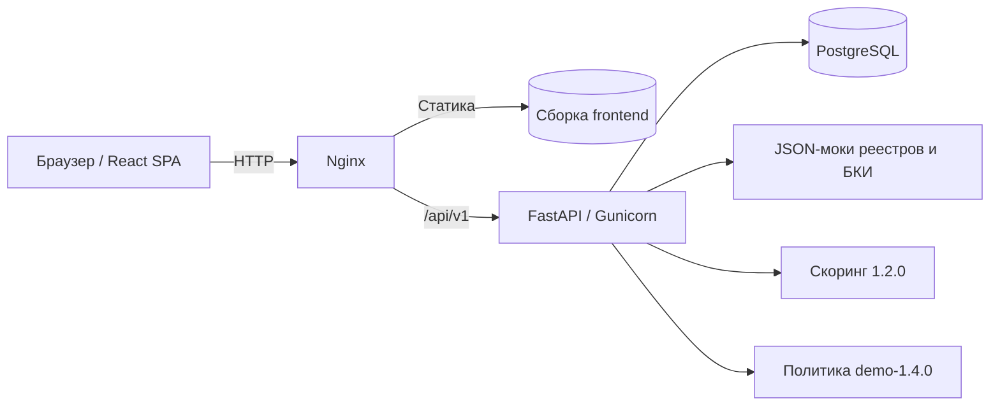
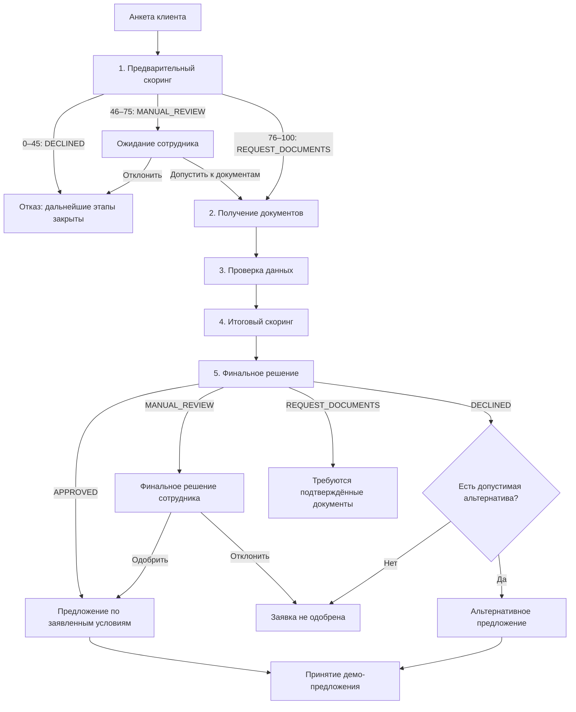
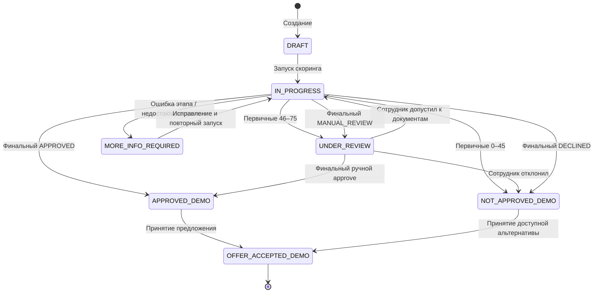
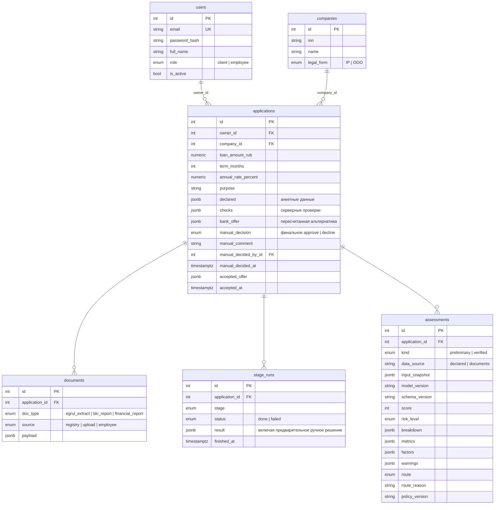

# Архитектура «Умного кредитного кабинета предпринимателя»

## 1. Границы решения и роли

Прототип демонстрирует путь предпринимателя от подачи заявки до решения: **анкета → предварительный скоринг → документы → серверные проверки → итоговый скоринг → решение и, при необходимости, ручное рассмотрение или альтернативные условия**. Процесс реализован в едином веб-приложении с клиентским кабинетом и кабинетом сотрудника банка.

Демонстрационный продукт — «Кредит на развитие бизнеса»: сумма **300 000–25 000 000 ₽**, срок **6–60 месяцев**, ставка **24% годовых**. Эти параметры заданы в `backend/app/core/policy.py` и не являются реальным тарифом банка. Подписание документов и выдача средств не реализованы: после принятия предложения клиентом демонстрационный сценарий завершается.

| Роль | Возможности |
|---|---|
| Клиент | Создание и редактирование своих заявок; загрузка документов; запуск доступных этапов; просмотр понятных статусов и предложений. В клиентском API не раскрываются баллы, коэффициенты, детали антифрода и внутренняя разбивка факторов |
| Сотрудник банка | Просмотр заявок и внутренней аналитики: баллов, факторов, расхождений и результатов этапов. Может принять **отдельное предварительное ручное решение** о допуске к документам и **отдельное финальное решение** по кредиту |

ЕГРЮЛ/ЕГРИП, БКИ и финансовая отчётность представлены синтетическими JSON-моками в `backend/mock_docs/`. Антифрод реализован демонстрационными детерминированными проверками в `verification.py`. Подключения к корпоративным системам банка нет.

## 2. Компоненты и технический стек



- **Frontend:** React, TypeScript, Vite, Tailwind CSS.
- **Backend:** Python, FastAPI, асинхронный SQLAlchemy, Alembic.
- **Хранилище:** PostgreSQL; результаты этапов и снимки данных — в том числе JSONB.
- **Инфраструктура:** Docker Compose и Nginx; авторизация — JWT, пароли хешируются bcrypt.

Слои backend (`backend/app/`): **API-роут → сервис → репозиторий → ORM-модель**.

| Слой | Ответственность |
|---|---|
| `api/` | HTTP-роуты, зависимости авторизации и проверки доступа, схемы ответа |
| `services/` | `pipeline.py` — последовательность этапов; `scoring.py` — чистый расчёт; `routing.py` — предварительная и финальная политика; `verification.py` — проверки документов; `alternative_offer.py` — пересчёт альтернатив; `statuses.py` — клиентские статусы; сервисы заявок и решений |
| `repositories/` | Запросы к PostgreSQL через SQLAlchemy |
| `models/`, `schemas/` | ORM-модели, входные и выходные Pydantic-схемы |
| `core/` | Конфигурация, политика продукта, перечисления, транзакции, безопасность |

Транзакционная обработка и разграничение доступа реализованы на стороне backend. Чужая заявка для клиента возвращает `404`; несанкционированное действие сотрудника — `403`. Клиентские проверки интерфейса не заменяют серверные.

## 3. Кредитный конвейер: пять этапов

В `backend/app/services/pipeline.py` определены пять последовательно запускаемых этапов. Результат каждого записывается в `stage_runs`, а каждый рассчитанный балл — в отдельный `assessments` со снимком входных данных. При повторном расчёте предыдущие оценки сохраняются в истории.



**Важно:** сотрудник, отклонивший заявку на финальной проверке, аннулирует ранее найденную альтернативу. Альтернатива может быть показана после финального автоматического `DECLINED`, но только если была безопасно пересчитана.

| Этап (`Stage`) | Вход | Действие и результат |
|---|---|---|
| `preliminary_scoring` | Заявленные клиентом сведения и параметры кредита | Расчёт балла и **предварительного** маршрута; оценка `preliminary` сохраняется отдельно. Средний риск останавливает конвейер до решения сотрудника |
| `documents` | ИНН, имеющиеся документы | Загрузка недостающих документов из мока реестра: `egrul_extract`, `bki_report`, `financial_report`; при нехватке документов — статус этапа `failed` и перечень недостающего |
| `verification` | Анкета и документы | Комплектность, идентичность компании, активность регистрации, допустимость продукта, согласованность долга, стоп-лист, доверенность источника и расхождения с анкетой |
| `final_scoring` | Сведения из подтверждающих документов и результаты проверок | Новый расчёт `verified`; балл, категория риска, маршрут, разница с предварительным баллом |
| `decision` | Финальный маршрут и проверенные данные | Фиксация решения и условий; поиск альтернативы **только при соблюдении ограничений**; ожидание сотрудника для `MANUAL_REVIEW` |

Этап со статусом `FAILED` означает техническую ошибку, нехватку или невалидность данных — **это не кредитный отказ**. При ошибке конвейер останавливается и показывает необходимые действия для исправления. Прямой запуск заблокированного этапа возвращает `409`; повторный `run_all()` при первичном ручном рассмотрении не запускает документы автоматически.

### 3.1. Предварительная маршрутизация

Функция `evaluate_preliminary_route()` в `backend/app/services/routing.py` использует **только первичный балл**, не имитируя итоговое банковское одобрение:

| Первичный балл | `route` | Поведение | Статус клиента |
|---:|---|---|---|
| 0–45 | `DECLINED` | Отказ; документы и дальнейшие этапы заблокированы | `NOT_APPROVED_DEMO` |
| 46–75 | `MANUAL_REVIEW` | Автоматическое продолжение заблокировано; сотрудник разрешает перейти к документам или отклоняет заявку | `UNDER_REVIEW` до ручного решения |
| 76–100 | `REQUEST_DOCUMENTS` | Допуск к получению документов; **не одобрение кредита** | `IN_PROGRESS` |

**Решение сотрудника на этом этапе имеет ограниченный смысл:** `approve` разрешает только запуск этапа `documents`; `decline` прекращает обработку. После допуска сотрудником финальное решение по кредиту принимается независимо от предварительного допуска. Повторно принять предварительное ручное решение по тому же результату нельзя (`409`).

При низком или среднем предварительном балле `run_all()` прекращает выполнение, даже если скоринг технически прошёл успешно. В `PipelineService._preliminary_blocked()` и `run_stage()` отдельно защищён запуск последующих этапов.

### 3.2. Финальная кредитная политика и стоп-факторы

Функция `evaluate_route()` вызывается **после итогового расчёта**; она применяет серверные проверки с приоритетом над баллом. В `core/policy.py` установлена демонстрационная версия `demo-1.4.0`.

| Проверка | Финальное поведение |
|---|---|
| Документы не подтверждены | `REQUEST_DOCUMENTS` |
| Регистрация прекращена или продукт недоступен | `DECLINED` |
| Статус регистрации или допустимости продукта не подтверждён | `MANUAL_REVIEW` |
| Антифрод `false` / неизвестен | `MANUAL_REVIEW` |
| Документы получены из недоверенного источника | `MANUAL_REVIEW` |
| Собственный капитал `≤ 0` (`NON_POSITIVE_EQUITY`) | `MANUAL_REVIEW` |
| Категория кредитной истории отсутствует или неизвестна | `MANUAL_REVIEW` на уровне кредитной политики; при отсутствии обязательного значения на входе скоринговая функция может вернуть ошибку валидации |
| Действующая просрочка или просрочка 90+ (`current_or_90plus_overdue`) | `MANUAL_REVIEW`, автоодобрение запрещено при любом балле |
| Стоп-факторов нет, балл 76–100 | `APPROVED` (демонстрационное одобрение) |
| Стоп-факторов нет, балл 46–75 | `MANUAL_REVIEW` |
| Стоп-факторов нет, балл 0–45 | `DECLINED` |

Результат антифрода и проверок формируется backend, а не берётся из неподтверждённых пользовательских флагов. Отдельная ручная проверка возможна даже при высоком балле, если сработал критический фактор. Прохождение первичного порога `76` не гарантирует итогового одобрения.

### 3.3. Альтернативные предложения

`backend/app/services/alternative_offer.py` использует проверенные финальные данные, а не произвольное уменьшение суммы кредита.

1. Предложение рассматривается только при подтверждённых документах, действующей регистрации, допустимом продукте, успешном антифроде и доверенном источнике документов; серьёзная просрочка исключает альтернативу.
2. Кандидаты подбираются в продуктовой сетке: сумма **300 000–25 000 000 ₽** с шагом **50 000 ₽**, срок **6–60 месяцев** с шагом **6 месяцев**, при демонстрационной ставке **24%**. Сумма не увеличивается относительно запроса, срок не сокращается.
3. Для каждого кандидата заново выполняются `score_application()` и `evaluate_route()`. Предлагается только вариант, который получает `APPROVED` после всех проверок.
4. Приоритет выбора: наибольшая допустимая сумма, затем наименьший допустимый срок. Если подходящего предложения нет, возвращается `null`.
5. После финального отказа сотрудника ранее рассчитанная альтернатива удаляется; принять её нельзя (`409`).

**Важно:** вычисленная альтернатива не равна выданному кредиту. Клиент видит альтернативные условия только в подходящем конечном статусе, предусмотренном `services/applications.py` и `services/statuses.py`.

## 4. Статусы заявки и ручные решения

Клиентский статус **не хранится отдельной колонкой**, а вычисляется из этапов и ручных решений функцией `resolve_client_status()` в `backend/app/services/statuses.py`.



**Решения хранятся по-разному:**

- **Предварительное ручное решение** сохраняется в JSONB-поле `stage_runs.result` соответствующего этапа: `review_decision`, `review_comment`, `reviewed_by_id`, `reviewed_at`. Отдельная миграция БД для этого не требуется.
- **Финальное ручное решение** хранится в `applications.manual_decision`, `manual_comment`, `manual_decided_by_id`, `manual_decided_at`.
- `APPROVED_DEMO` отражает итоговую демонстрационную доступность предложения, а `OFFER_ACCEPTED_DEMO` — согласие клиента, **не выдачу средств**.
- `MORE_INFO_REQUIRED` возникает при ошибке этапа или недостатке данных, а не из-за низкого скорингового балла.

Изменение анкеты сбрасывает этапы и требует повторного расчёта. Изменение документов сбрасывает зависимые этапы с `documents`; история оценок остаётся для аудита изменений (например, **92 → 62**). Старые заявки, рассчитанные до обновления политики, автоматически не пересчитываются.

## 5. Модель данных



Уникальность: `documents(application_id, doc_type)` и `stage_runs(application_id, stage)`. Оценки (`assessments`) сохраняются вместе с версией модели, входными данными и кредитным маршрутом; один бизнес может иметь несколько оценок на разных этапах. Предварительный ручной допуск в `stage_runs.result` не равен финальному `manual_decision` в `applications`.

## 6. Права доступа и безопасность

- JWT для обеих ролей, пароли хешируются; доступ к чужой заявке клиента запрещён на сервере.
- `checks` формируются backend; пользователь не может отправить подтверждение антифрода или регистрации вместо проверяющей системы.
- Клиент не может заменить документ из реестра (`409`). Документ, загруженный клиентом, считается недоверенным до подтверждения сотрудником; такой источник не допускает автоматического одобрения.
- Для клиента результаты этапов в `/pipeline` скрываются (`result: null`); внутренние метрики и причины антифрод-проверки доступны только авторизованному сотруднику.
- Попытка запустить заблокированный этап либо повторно применить уже принятое ручное решение приводит к `409`.
- Ошибки API возвращаются с русским `detail`; валидация может дополнительно указывать `field` для подсветки в форме.

## 7. Проверка реализации и ограничения MVP

Команды из корня репозитория:

```bash
# Первый запуск: создать .env из .env.example и проверить значения
# Windows PowerShell: Copy-Item .env.example .env
# Linux/macOS: cp .env.example .env
docker compose up --build
```

Приложение: <http://localhost:8080>; Swagger: <http://localhost:8080/api/docs>.

Тестирование backend:

```bash
cd backend
uv run --with pytest python -m pytest -q
```

Ключевые сценарии описаны в [TEST_SCENARIOS.md](TEST_SCENARIOS.md): **45 → отказ**, **66 → ручное рассмотрение без автоперехода**, **76 → документы**, **92 → 62 после проверки**, а также стоп-факторы и альтернативные условия. Синтетическая эталонная выборка содержит 1 500 валидных и 34 ошибочных примера для сверки математической модели. Проверка примеров не измеряет точность прогнозирования реальных дефолтов.

**Ограничения:**

- Скоринг — экспертная балльная модель, **не обученная ML/PD-модель**. Балл 80/100 не означает 80% вероятности одобрения.
- Политика `demo-1.4.0`, пороги и продуктовые ставки не являются правилами или тарифами Альфа-Банка.
- Включены синтетические финансовые данные и моки реестров/БКИ/антифрода, а не реальные банковские интеграции.
- Для ИП требуется отдельное согласование методики определения `equity_rub`; личный возраст, ПДН физического лица, прожиточный минимум и регион не участвуют в балльной оценке.
- Подписание договора, выдача кредита, промышленные процедуры KYC/AML, независимая валидация модели и мониторинг риска в MVP не реализованы.

См. также [основной README](../README.md), [тестовые сценарии](TEST_SCENARIOS.md) и [API](API.md).
