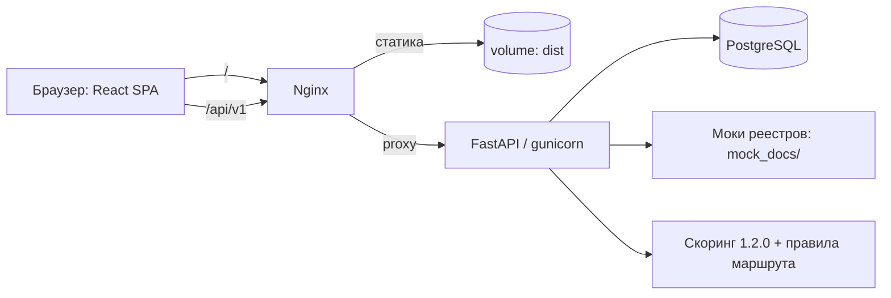
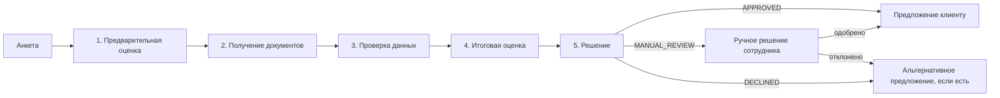
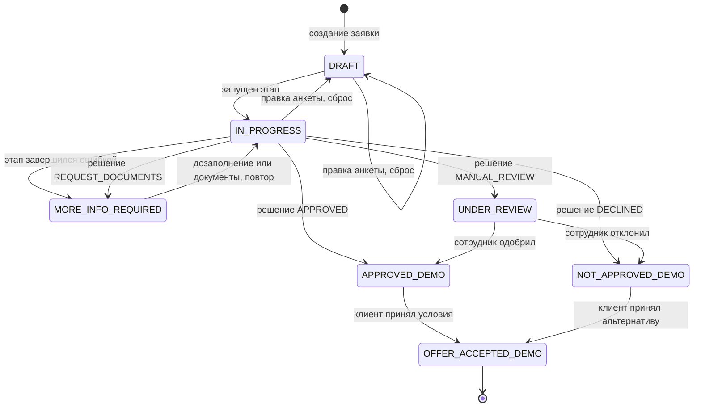
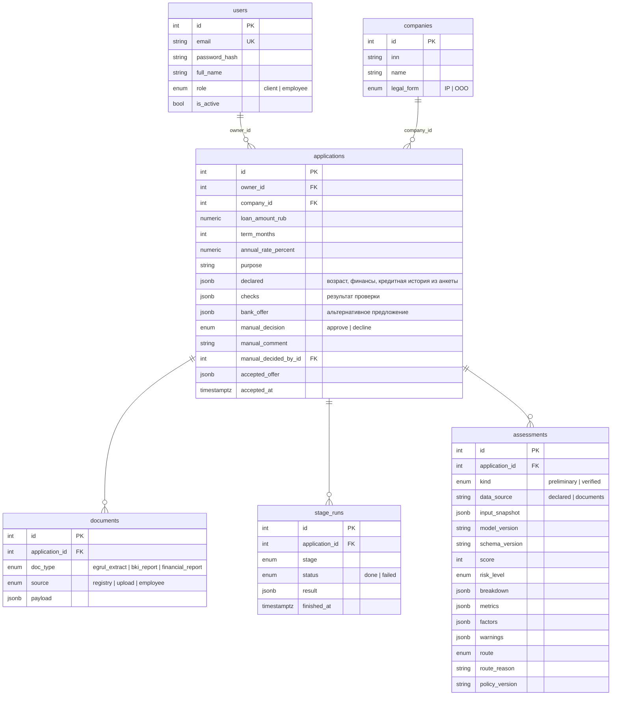

# Архитектура

## Границы решения

Прототип покрывает путь предпринимателя от заявки до результата и внутреннюю обработку заявки
банком в одном продукте. Один кредитный продукт («Кредит на развитие бизнеса»: 300 000 –
25 000 000 ₽, 6–60 мес., ставка 24% годовых — демо-значения из `backend/app/core/policy.py`).
Подписание документов и выдача средств не реализуются: клиент принимает демонстрационное
предложение, на этом заявка завершается.

Роли:

| Роль | Что видит и делает |
|---|---|
| Клиент | Создаёт и правит свои заявки, загружает документы, запускает проверку, видит статус, понятный текст, следующий шаг и условия предложения. Баллы, коэффициенты и результаты проверок ему не отдаются |
| Сотрудник банка | Видит все заявки целиком: оценки с разбивкой по факторам, метрики, проверки, расхождения, JSON каждого этапа; принимает ручное решение по заявкам в статусе `MANUAL_REVIEW` |

Внешние системы смоделированы: реестр ЕГРЮЛ/ЕГРИП, БКИ и финансовая отчётность — JSON-моки по
ИНН в `backend/mock_docs/`, антифрод — детерминированные правила в `verification.py`.
Интеграции с корпоративными системами банка нет.

## Компоненты

Слои backend (`backend/app/`) — жёсткая граница «роут → сервис → репозиторий → модель»:

| Слой | Содержимое |
|---|---|
| `api/` | Роуты (без SQL и бизнес-правил), зависимости доступа (`CurrentUser`, `EmployeeUser`), сборка сервисов, формат ошибок |
| `services/` | `pipeline.py` — оркестрация этапов; `scoring.py`, `routing.py`, `verification.py`, `alternative_offer.py` — чистые функции предметной логики; `applications.py`, `offers.py`, `auth.py`, `access.py` — классы с сессией |
| `repositories/` | Все запросы SQLAlchemy |
| `models/`, `schemas/` | ORM-модели и Pydantic-схемы |
| `core/` | Конфигурация, БД и транзакция запроса, перечисления, кредитная политика, JWT |

Весь запрос выполняется в одной транзакции (`TransactionMiddleware`): коммит при ответе `< 400`,
откат иначе. Чужая заявка для клиента всегда `404`, а не `403`.

## Кредитный конвейер

Пять этапов, строго по порядку; результат каждого хранится в `stage_runs` (JSON), оценки — в
`assessments`. Этап можно перезапустить: его результат и всех последующих сбрасывается.

| Этап | Вход | Что делает | Результат |
|---|---|---|---|
| `preliminary_scoring` | Данные анкеты клиента | Считает оценку по заявленным данным. Документы не подтверждены, поэтому маршрут всегда `REQUEST_DOCUMENTS` | Снимок оценки `preliminary` |
| `documents` | ИНН компании | Подтягивает недостающие документы из мок-реестра; загруженные клиентом сохраняются. Если чего-то нет — этап `failed` со списком недостающих | Документы `egrul_extract`, `bki_report`, `financial_report` |
| `verification` | Документы и анкета | Серверные проверки: комплект, совпадение с ЕГРЮЛ (ИНН и наименование), регистрация действует, соответствие продукту, согласованность долга БКИ и отчётности, стоп-лист, источник документов, расхождения анкеты с документами | `documents_verified`, `registration_active`, `product_eligible`, `fraud_check_passed`, `documents_trusted`, список проверок |
| `final_scoring` | Подтверждённые данные из документов | Считает оценку по документам и определяет маршрут. Сохраняет **новый** снимок `verified`, предыдущий остаётся | Снимок оценки `verified`, дельта к предварительной |
| `decision` | Итоговый маршрут | Фиксирует маршрут; для `DECLINED` и `MANUAL_REVIEW` ищет альтернативные условия | Маршрут, условия, `alternative_offer` |

Маршрут (порядок правил — как в `credit_policy.py`): документы не подтверждены →
`REQUEST_DOCUMENTS`; регистрация неактивна или продукт не подходит → `DECLINED`; антифрод не
пройден, документы не из доверенного источника или капитал ≤ 0 → `MANUAL_REVIEW`; балл > 75 → `APPROVED`; 46–75 → `MANUAL_REVIEW`;
0–45 → `DECLINED`. Политика демонстрационная, не политика банка.

Альтернативное предложение: перебор сумм (шаг 50 000 ₽, вниз от запрошенной) и сроков (шаг 6
мес., вверх от запрошенного) в границах продукта; выбирается максимальная сумма, при равенстве —
кратчайший срок, для которой та же модель и те же проверки дают `APPROVED`. Если регистрация
неактивна, продукт не подходит или антифрод не пройден, предложения нет.

## Диаграмма состояний заявки

Статус клиента не хранится, а вычисляется из этапов, решения сотрудника и признака принятия
(`services/statuses.py`).

Правка анкеты сбрасывает все этапы; загрузка документа — этапы начиная с получения документов.
Старые оценки сохраняются, новая оценка не затирает предыдущую.

## Модель данных

Уникальность: `documents (application_id, doc_type)`, `stage_runs (application_id, stage)`.
Оценки версионируются: каждый запуск скоринга добавляет строку с полным снимком входа, версией
модели и схемы, версией политики и маршрутом — так видно, как менялась оценка (например, 92 → 62).

## Безопасность

- JWT (HS256) для обоих ролей, пароли — bcrypt;
- доступ к заявке проверяется на сервере по владельцу, чужая заявка — `404`;
- проверки (`checks`) формирует только сервер; документы из реестра клиент заменить не может
  (`409`), а загруженные клиентом считаются недоверенными: заявка с ними никогда не
  одобряется автоматически и уходит на ручное рассмотрение. Документы, загруженные сотрудником,
  доверенные (источник `employee`);
- клиентские ответы не содержат баллов, метрик и причин антифрод-проверки;
- все ошибки — `{"detail": "текст на русском"}`; для ошибок валидации и скоринга добавляется
  `field` — путь поля для подсветки в форме.

## Ограничения и допущения

- Оценка — экспертная модель без обучения на реальных данных, балл не равен вероятности дефолта;
- `equity_rub` для ИП берётся из финансовой отчётности как есть; метод определения капитала ИП не
  согласован;
- политика маршрутов и пороги — демонстрационные;
- мок БКИ отдаёт готовую категорию кредитной истории; отсутствие ответа реестра трактуется как
  «документ не найден» и запрашивается у клиента, а не как `no_history`.
